# Pramaan AI: Cited Appeals for Denied Health-Insurance Claims

**Turn insurance denials into cited appeals.** *Pramaan* (Hindi) means proof. Pramaan AI reads a denied claim, finds the payer's own coverage policy with retrieval-augmented generation (RAG), pulls matching proof from the patient's chart, and drafts an appeal letter where every statement points back to its source.

[](https://github.com/sonamsharma0309/Pramaan-AI/actions/workflows/ci.yml)


> Minor project, Department of Computer Science and Applications, GLA University, Mathura (Team 105).

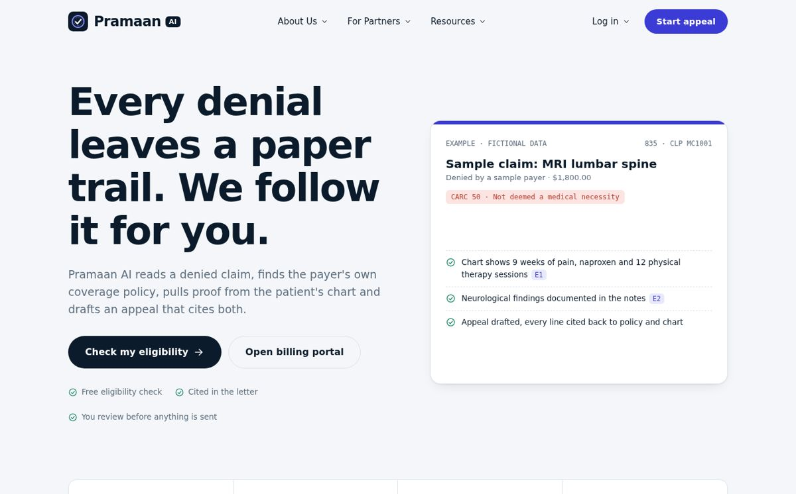

---

## Table of contents
1. [Why Pramaan AI](#why-pramaan-ai)
2. [What it does](#what-it-does)
3. [How it works](#how-it-works)
4. [Overview](#overview)
5. [Unique features](#unique-features)
6. [Features](#features)
7. [Tech stack](#tech-stack)
8. [Architecture](#architecture)
9. [Diagrams](#diagrams)
10. [Security model](#security-model)
11. [The AI / ML pipeline in detail](#the-ai--ml-pipeline-in-detail)
12. [Roles and permissions](#roles-and-permissions)
13. [Data sources](#data-sources)
14. [Quick start](#quick-start)
15. [API keys: what, where, why](#api-keys-what-where-why)
16. [API overview](#api-overview)
17. [Project structure](#project-structure)
18. [Development, testing and CI/CD](#development-testing-and-cicd)
19. [Screenshots](#screenshots)
20. [Completed features](#completed-features)
21. [Limitations and honesty notes](#limitations-and-honesty-notes)
22. [HIPAA and privacy warning](#hipaa-and-privacy-warning)
23. [Roadmap](#roadmap)
24. [Project team](#project-team)
25. [License](#license)


---

## Why Pramaan AI
Health insurers deny large numbers of claims and prior-authorisation requests for administrative errors or policy reasons. Most of these are never appealed because the manual process is slow: staff read policy manuals, hunt for chart evidence and write each letter by hand. Pramaan AI automates that chain and keeps a human in charge of the final decision.

## What it does
- **Reads remittances**: parses ANSI X12 **835 / ERA** files, extracts denial code, group code, remark code, amounts, and ignores patient-responsibility lines.
- **Explains the denial** using the bundled **CARC / RARC / EOB dataset** (93 / 197 / 1,873 entries) and classifies it (medical necessity, authorisation, coding, administrative, ...).
- **Retrieves the payer policy** (TF-IDF, optional sentence-transformer embeddings) and extracts its coverage criteria.
- **Maps chart evidence** to each criterion and marks it *met / partial / missing*, listing what to add.
- **Drafts a cited appeal** (`[P#]` policy, `[E#]` chart evidence) with Claude or an offline template. If no payer policy exists it says so honestly instead of guessing.
- **Estimates appeal strength** with a logistic-regression model that is labelled *synthetic* until it is retrained on real outcomes.
- **Tracks the whole lifecycle**: deadlines, status, outcome, recovered revenue, per-claim timeline, audit log.
- **Exports** a **watermarked PDF packet** (letter + evidence appendix + policy excerpts), CSVs and a ZIP of all packets.

Two portals share one engine: **Patient Portal** (guided 5-step intake) and **Billing Portal** (835 import, bulk actions, private policy library, analytics). An **Admin Console** manages users, messages, audit and health.

---

## How it works
1. **Import or enter the denial.** Billers import an ANSI X12 835 remittance (or add a claim by hand). Patients use a guided 5-step intake.
2. **Understand the denial.** The CARC / RARC / EOB dataset explains every code, classifies the denial (medical necessity, authorisation, coding, administrative, ...) and flags contractual or patient-responsibility lines as non-appealable.
3. **Find the payer's own policy.** Retrieval over the shared policy library plus your organisation's private uploads pulls the coverage criteria that apply to the service.
4. **Prove it from the chart.** Each policy criterion is matched to a sentence in the clinical notes and marked *met*, *partial* or *missing*, with a list of what to add.
5. **Draft a cited appeal.** An AI provider (Gemini, Ollama, Claude or any OpenAI-compatible API) or the offline template writes the letter. Every statement points to a policy clause `[P#]` or a chart sentence `[E#]`.
6. **Track it to recovery.** Deadlines, status, outcome and recovered revenue are tracked per claim, and a watermarked PDF packet is ready to send.

See [docs/ARCHITECTURE.md](docs/ARCHITECTURE.md) for the design notes and [docs/DEMO_SCRIPT.md](docs/DEMO_SCRIPT.md) for a 5-minute demo walkthrough.

---

## Overview
Pramaan AI is a decision-support platform that turns a denied claim into an appeal grounded in evidence: the payer's own coverage policy on one side, the patient's own chart on the other.

- **Cited, never invented.** A letter that cites a policy clause or chart sentence that was not actually retrieved is discarded and replaced by the deterministic template.
- **Works with no API keys.** With an empty `.env` the app runs fully offline: template letters, local TF-IDF retrieval, SQLite, no email.
- **Privacy by design.** Names, DOB, SSN, phone, email and MRN are replaced by placeholders before any text reaches an AI provider, then restored in the final letter.
- **Honest about uncertainty.** The win estimate is labelled *synthetic* until it is retrained from at least 50 real outcomes, and the letter says so plainly when no payer policy was found.

## Unique features
- **Citation guard.** Every `[P#]` / `[E#]` in an AI letter is checked against what was retrieved. Anything else triggers a fallback (`template:fallback-citation`).
- **Evidence coverage map.** Policy criteria are shown as *met / partial / missing* next to the matching chart sentence, plus a "what to add" list.
- **Honest win estimate.** A logistic-regression model with per-factor contributions, clearly badged *synthetic* or *learned from outcomes*.
- **Watermarked PDF packet.** Letter, evidence appendix and policy excerpts, with a tiled watermark, packet ID and footer on every page.
- **Replay-proof sessions.** Short-lived access tokens, rotating refresh tokens, and revocation of every session if an old refresh token is replayed.
- **Bring your own AI.** Switch between Gemini, Ollama (local), Claude or any OpenAI-compatible API with one environment variable.

---

## Features

### For patients
- Guided 5-step intake for a denied claim
- Plain-language explanation of the denial code
- Cited appeal letter and downloadable PDF packet
- Claim timeline, status and deadline tracking
- Optional two-factor authentication (TOTP) and notifications

### For billers
- Import ANSI X12 835 / ERA files
- Searchable, sortable claims table with bulk *Run analysis* and *Generate appeals*
- Private policy library per organisation, plus a shared read-only library
- Invite teammates with an organisation invite code
- Dashboard analytics (revenue at risk, recovered, win rate by category, top denial codes, payer exposure)
- CSV exports and a ZIP of all PDF packets

### For admins
- User management, contact messages, audit log and system health
- Created only with `scripts/create_admin.py` (never through sign-up)
- Metadata access only: no cross-user claim or chart data

---

## Tech stack
| Layer | Technology |
|---|---|
| Frontend | Vanilla JavaScript single-page app, CSS, Chart.js (CDN) |
| Backend | FastAPI, Pydantic v2, Uvicorn |
| Database | SQLite (default) or PostgreSQL, SQLAlchemy 2.0 Core, Alembic migrations |
| Auth and security | bcrypt, PyJWT, httpOnly cookies, double-submit CSRF, optional TOTP 2FA, optional Google sign-in |
| AI and ML | Gemini, Ollama, Claude or any OpenAI-compatible API (all optional), scikit-learn (TF-IDF, logistic regression), optional sentence-transformers |
| Documents | ReportLab (PDF), pypdf, python-docx, Tesseract OCR with pdf2image |
| Reference data | CARC / RARC / EOB dataset, X12 835 parser, NLM ICD-10 lookup |
| DevOps | Docker, Docker Compose, nginx (optional profile), GitHub Actions (CI and CD), ruff, pytest, pre-commit |

---

## Architecture

### System overview
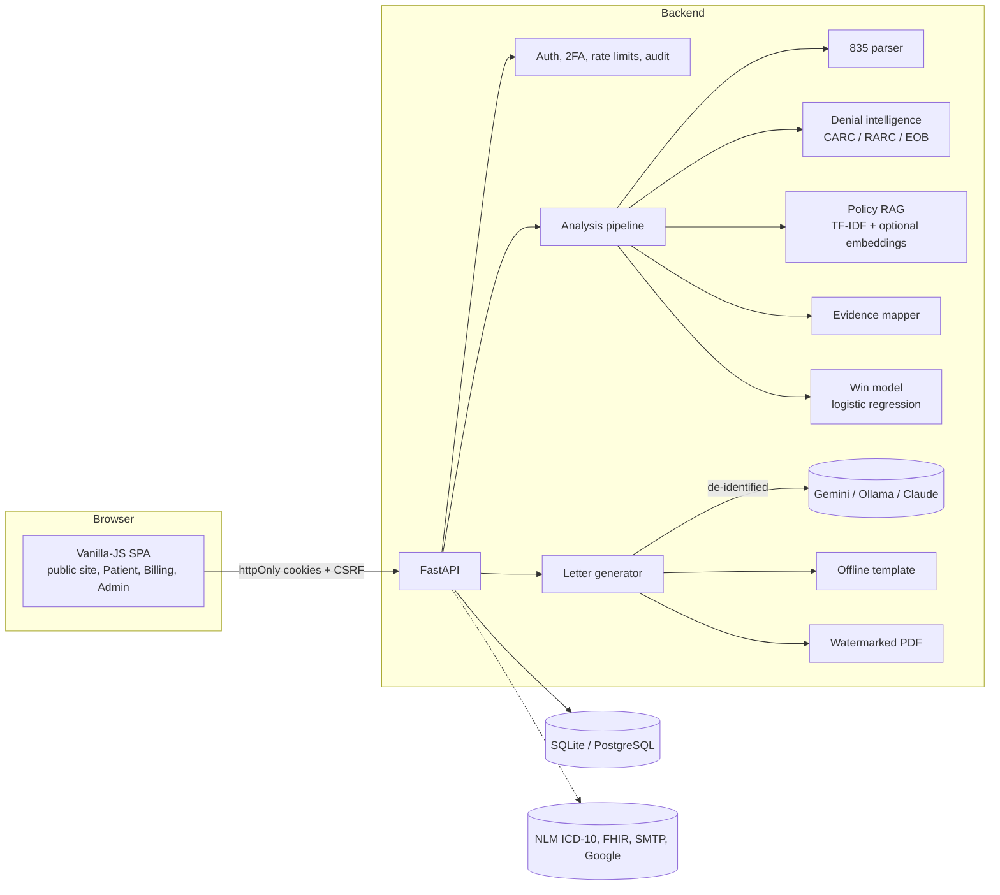

### Layered backend design
- `routers/`: HTTP transport, request and response mapping (auth, claims, appeals, policies, dashboard, exports, admin, ...)
- `services/`: reusable business logic (835 parser, denial intelligence, RAG, evidence mapping, letter generation, win model, PDF, de-identification)
- `security.py`: passwords, JWT sessions, CSRF, role guards, rate limiting
- `schemas.py`: Pydantic request and response contracts
- `models.py` and `database.py`: SQLAlchemy 2.0 table definitions and database access
- `config.py`: every setting, read from environment variables or `.env`

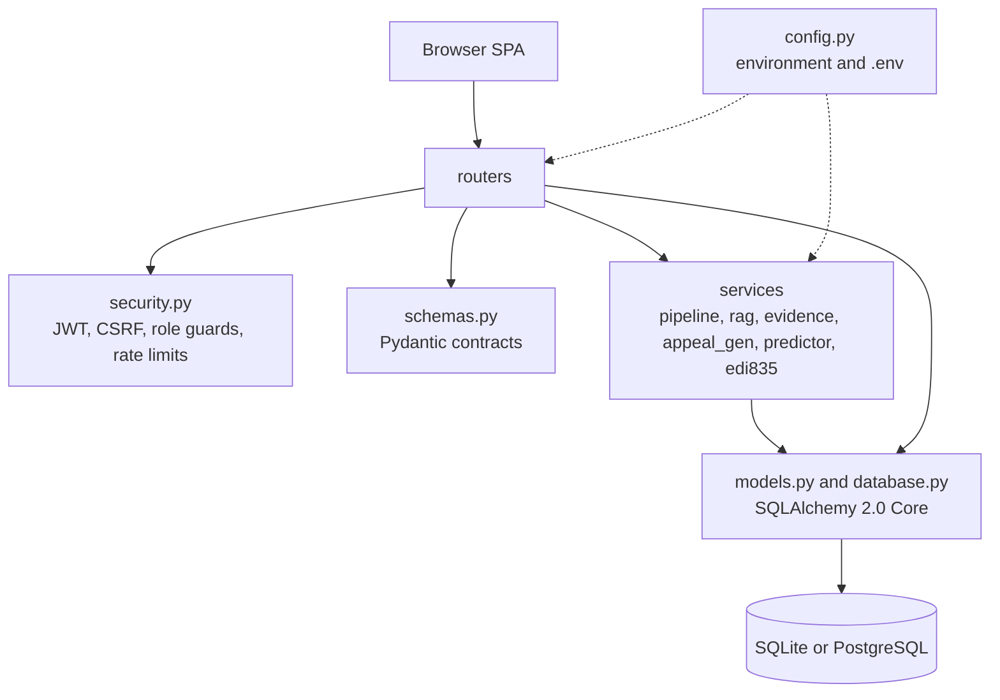

### Appeal pipeline
The pipeline runs in two steps: **analysis** (`pipeline.py`) and **letter generation** (`appeal_gen.py`).

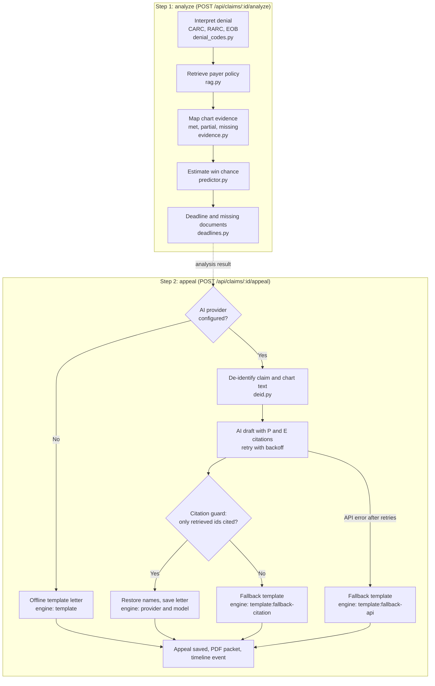

---

## Diagrams

### Authentication and session flow
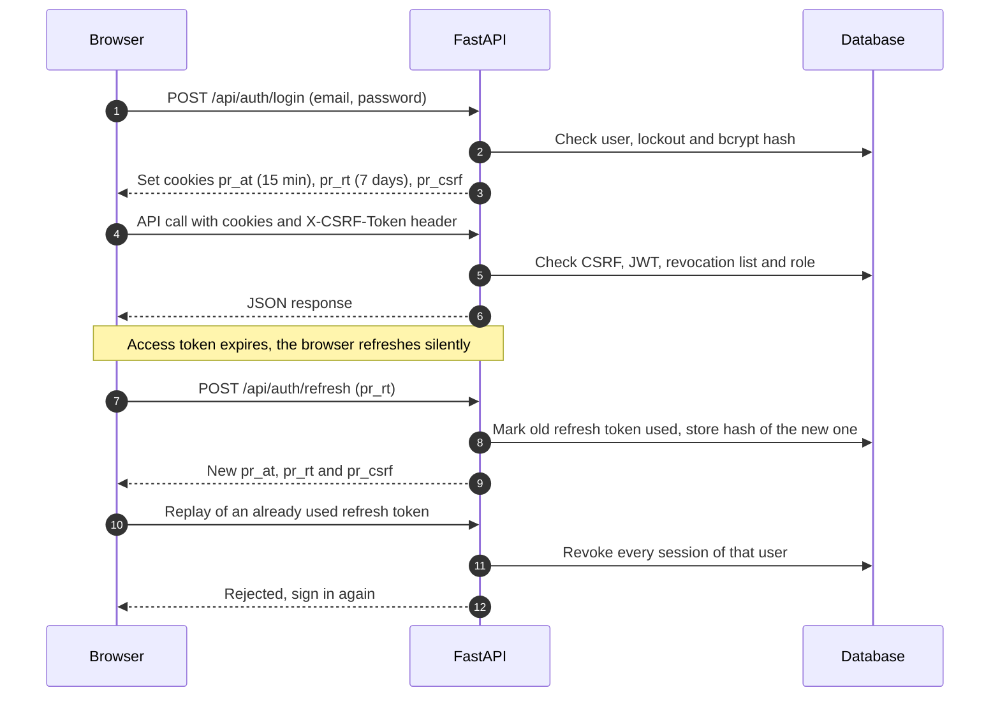

### Authorization (RBAC) flow
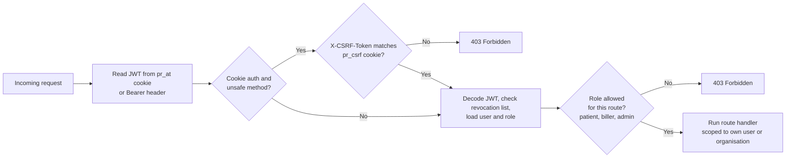

### Claim lifecycle
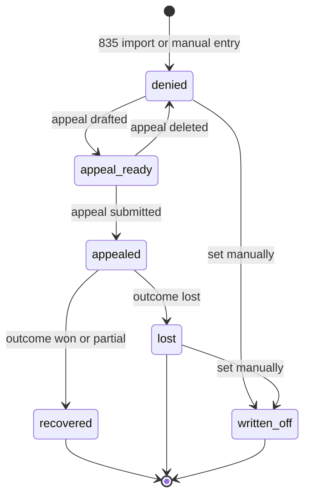

### Database schema
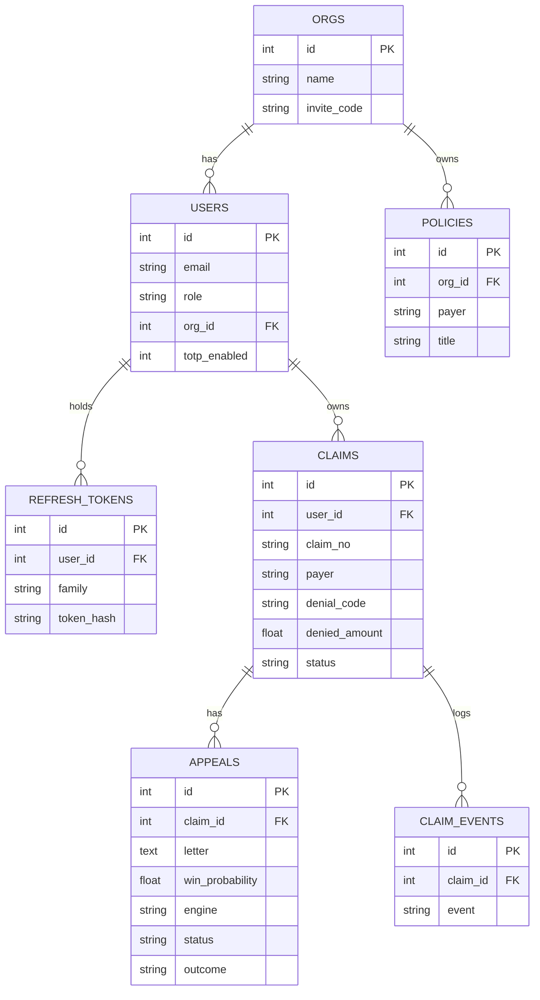
Standalone tables: `revoked_tokens`, `audit_log`, `notifications`, `contact_messages`, `icd_cache`.

---

## Security model
- **Sessions**: 15-minute access token + rotating 7-day refresh token in `httpOnly`, `SameSite=Lax` cookies (`Secure` when `COOKIE_SECURE=true`); **double-submit CSRF** (`X-CSRF-Token`). **Replaying an old refresh token revokes every session of that user.** The frontend never holds a token and refreshes silently.
- **Passwords**: bcrypt (cost 12), policy checks, constant-time verification for unknown emails, lockout after 5 failures, single-use reset links that also revoke sessions.
- **2FA**: optional RFC 6238 TOTP with QR enrolment. Email verification toggle (`REQUIRE_VERIFIED`).
- **PHI minimisation**: names, DOB, SSN, phone, email, MRN are replaced by placeholders before text reaches the AI provider, then restored (`DEIDENTIFY_BEFORE_LLM=true`).
- **Citation guard**: an LLM letter citing a `[P#]`/`[E#]` that was not retrieved is discarded for the deterministic template. API errors retry with exponential backoff.
- **Web hardening**: Content-Security-Policy, `X-Frame-Options`, request IDs in logs, strict CORS, per-IP rate limits (configurable), SSRF guard on server-side fetches, upload type and size validation, CSV formula-injection neutralisation.
- **Audit log**: sign-ins, failures, replay detection, appeal views/PDFs, policy uploads, exports.
- **Anti-copy**: every PDF page carries a tiled *PRAMAAN AI* watermark, a packet ID and a footer. This deters casual reuse; it is not DRM.

### Security controls at a glance
| Control | Implementation | File |
|---|---|---|
| Password hashing | bcrypt with policy checks and constant-time verification | `backend/security.py` |
| Sessions | 15-minute access JWT and rotating 7-day refresh token in httpOnly cookies | `backend/security.py` |
| CSRF protection | Double-submit token in the `X-CSRF-Token` header | `backend/security.py` |
| Refresh-token replay | Revokes every session of the user | `backend/security.py` |
| Account lockout | Locks after repeated failed sign-ins | `backend/routers/auth.py` |
| Two-factor authentication | Optional RFC 6238 TOTP with QR enrolment | `backend/services/totp.py` |
| Role guards | `patient`, `biller`, `admin` checks on routes | `backend/security.py` |
| Rate limiting | Per-IP limits on sign-in and on the whole API | `backend/security.py`, `backend/main.py` |
| Security headers | Content-Security-Policy and request IDs | `backend/main.py` |
| PHI minimisation | De-identification before text reaches an AI provider | `backend/services/deid.py` |
| Citation guard | Rejects letters that cite unretrieved sources | `backend/services/appeal_gen.py` |
| SSRF guard | Safe server-side fetches | `backend/services/net.py` |
| Upload limits | File type and size validation | `backend/services/files.py` |
| CSV formula-injection guard | Neutralises formulas in CSV exports | `backend/routers/exports.py` |
| Audit log | Sign-ins, failures, replays, PDFs, uploads, exports | `backend/services/audit.py` |
| SQL injection | Parameterised queries through SQLAlchemy | `backend/database.py` |

---

## The AI / ML pipeline in detail
1. **Parse** (`services/edi835.py`): real X12 segment parser (ISA/ST/BPR/N1/CLP/NM1/SVC/CAS/DTM/LQ), multi-transaction, `PR` lines excluded.
2. **Interpret** (`services/denial_codes.py`): official descriptions from the dataset plus category, appeal strategy and a prior; contractual and patient-responsibility codes are flagged non-appealable. Group codes and payer deadlines from `services/deadlines.py`.
3. **Retrieve** (`services/rag.py`): payer-filtered, org-isolated policy chunks scored by TF-IDF (uni+bi-grams) plus a procedure-code boost; with `EMBEDDINGS=true` scores are blended with sentence-transformer similarity.
4. **Map evidence** (`services/evidence.py`): chart sentences tagged (labs, imaging, exam, failed treatment, duration, rationale, function); each policy criterion is matched to the best sentence and marked met / partial / missing. Only payer-specific policies define criteria.
5. **Draft** (`services/appeal_gen.py`): Claude (grounded only on retrieved context) or template; states honestly when no payer policy was found.
6. **Estimate** (`services/predictor.py`): logistic regression with per-factor contributions. Starts **synthetic**; `python scripts/train_predictor.py` retrains it from your recorded outcomes once at least 50 exist, after which the UI badge changes to *learned from outcomes*.

## Roles and permissions
| Capability | Patient | Biller | Admin |
|---|:--:|:--:|:--:|
| Sign up in the UI | yes | yes | **no** (`scripts/create_admin.py` only) |
| Own claims, appeals, timeline, PDF | yes | yes | n/a |
| Import 835 files | no | yes | no |
| Private policy library (per organisation) | read shared | add / delete own org's | no |
| Invite teammates (org invite code) | no | yes | no |
| Dashboard analytics, exports | own data | own data | no |
| Users, messages, audit log, system health | no | no | yes |
| Cross-user data access | never | never | metadata only |

Patients cannot use the Billing Portal and vice versa; wrong-portal sign-in is rejected (403) on the API and guarded in the router.

## Data sources
| File | Used for |
|---|---|
| `backend/data/carc_rarc.json` (from *CARC-RARC Consolidated List, posted 02/12/2026*) | Denial and remark code descriptions, EOB crosswalk |
| `backend/data/group_codes.csv` | CO / PR / OA / PI / CR explanations |
| `backend/data/appeal_rules.csv` | Appeal deadline windows. Rows not marked verified are shown as **unverified baselines** |
| `backend/data/sample_835.edi`, `sample_835_synthetic.edi` | **Fictional** demo remittances |
| `backend/data/policies/*.txt`, `demo.py` | **Fictional** payer policies and patient charts |

---

## Quick start
**With Docker** (app + PostgreSQL, nothing else to install):
```bash
cp .env.example .env          # 1. copy the config
#                               2. paste your keys into .env (all optional, see API keys below)
docker compose up --build     # 3. start everything  ->  http://localhost:8000
```
With the nginx reverse proxy on port 80: `docker compose --profile proxy up --build`.

**Without Docker** (SQLite):
```bash
./run.sh          # macOS / Linux
run.bat           # Windows
# or: make install && make dev
```

Then open **http://localhost:8000**:
1. *Log in -> Billing Portal -> Create account*.
2. On the empty dashboard click **Load sample data** (fictional claims, policies and charts).
3. Open a denial -> **Analysis and appeal** -> **Generate appeal** -> download the PDF.

Create an admin (never possible through sign-up):
```bash
python scripts/create_admin.py --email you@example.org --name "Your Name"   # then sign in at /#/login/admin
# Docker: docker compose exec app python scripts/create_admin.py --email you@example.org --name "Your Name"
```

> With an **empty `.env`** everything still works offline: template letters, local retrieval, SQLite, no email. Features whose keys are missing are hidden or degrade with a clear message (the header shows **AI: on/off**).

## API keys: what, where, why
Every key is optional. Put them in `.env` (never commit that file).

| Variable | Needed for | Where to get it |
|---|---|---|
| `LLM_PROVIDER` + `GEMINI_API_KEY` / `OLLAMA_*` / `ANTHROPIC_API_KEY` / `OPENAI_COMPAT_*` | AI-written letters and *Regenerate*. **Free options:** Gemini ([aistudio.google.com](https://aistudio.google.com) -> Get API key) or Ollama (local, [ollama.com](https://ollama.com)). Paid: Claude ([console.anthropic.com](https://console.anthropic.com)). Empty = built-in template | see `.env.example` |
| `GOOGLE_CLIENT_ID` | "Continue with Google" button | [Google Cloud Console](https://console.cloud.google.com) -> APIs & Services -> Credentials -> OAuth client ID (Web). Add your `APP_URL` under *Authorised JavaScript origins*. Use the Client ID only |
| `SMTP_HOST` `SMTP_PORT` `SMTP_USER` `SMTP_PASSWORD` `SMTP_FROM` | Password-reset and verification emails, contact-form notifications | Any SMTP service: Gmail (App Password), Brevo, SendGrid SMTP, Mailgun, Zoho |
| `CONTACT_TO` | Inbox for the Contact / Partner form | Your own email address |
| `SECRET_KEY` | Stable JWT signing key | `python -c "import secrets;print(secrets.token_urlsafe(64))"` (auto-generated if empty) |
| `POSTGRES_PASSWORD` | Docker PostgreSQL password | Choose a strong one |
| `DATABASE_URL` | External PostgreSQL instead of the bundled one | Your provider's connection string |
| `FHIR_ENABLED`, `FHIR_BASE` | Importing chart notes from a FHIR R4 server | Public test server `https://hapi.fhir.org/baseR4` or your hospital's endpoint |
| `APP_URL`, `COOKIE_SECURE`, `CORS_ORIGINS` | Production URL, HTTPS cookies, cross-site access | Your deployment |

No key is needed for: ICD-10 lookup (free NLM Clinical Tables API), the CARC/RARC dataset, OCR (Tesseract is installed in the Docker image), or the win-probability model. See `.env.example` for every variable with comments.

## API overview
Interactive docs at `/api/docs`. Main groups:

| Group | Endpoints |
|---|---|
| Auth | `POST /api/auth/{register,login,logout,refresh,forgot,reset,verify,google}`, `GET/PATCH /api/auth/me`, `POST /api/auth/2fa/{setup,enable,disable}` |
| Claims | `GET /api/claims` (search, filter, sort, paginate), `POST /api/claims`, `POST /api/claims/import-835`, `POST /api/claims/{id}/{analyze,appeal,notes-file}`, `POST /api/claims/bulk/{analyze,appeal}`, `GET /api/claims/{id}/timeline` |
| Appeals | `GET/PATCH /api/appeals/{id}`, `POST /api/appeals/{id}/regenerate`, `GET /api/appeals/{id}/pdf` |
| Policies | `GET/POST/DELETE /api/policies`, `POST /api/policies/{upload,search}` |
| Reference | `GET /api/codes/{search,list,carc/{code}}`, `GET /api/icd/search`, `GET /api/payers`, `GET /api/procedures` |
| Analytics | `GET /api/dashboard`, `GET /api/notifications`, `GET /api/export/{claims.csv,outcomes.csv,packets.zip}` |
| Public | `GET /api/site/content`, `GET /api/public/stats`, `POST /api/public/eligibility`, `POST /api/contact`, `GET /api/health` |
| Admin | `GET /api/admin/{overview,users,messages,audit,system}` |
| FHIR | `GET /api/fhir/{status,patients}`, `POST /api/fhir/claims/{id}/import` (flag-gated) |

`GET /api/health` reports which integrations are active (ai, mail, google, fhir, ocr, embeddings), the database type, policy chunk count and model kind.

## Project structure
```
pramaan-ai/
|-- .github/workflows/ci.yml        lint, tests, migrations, docker build
|-- .github/workflows/cd.yml        publishes the Docker image to ghcr.io after CI passes
|-- alembic/                        migrations (0001_initial)
|-- backend/
|   |-- main.py                     app, middleware (CSP, request id, rate limit)
|   |-- config.py database.py models.py security.py schemas.py
|   |-- routers/                    auth claims appeals policies dashboard codes
|   |                               exports notifications admin icd fhir misc
|   |-- services/                   edi835 denial_codes deadlines rag evidence predictor
|   |                               pipeline appeal_gen deid files net totp mail audit
|   `-- data/                       datasets, sample 835 files, policies, site_content.json
|-- frontend/
|   |-- index.html css/app.css
|   `-- js/  app api ui public auth  portal/{shell dashboard claims appeals analysis library settings admin index}
|-- scripts/                        create_admin.py train_predictor.py wait_for_db.py
|-- deploy/                         entrypoint.sh nginx.conf
|-- docs/                           ARCHITECTURE.md DEMO_SCRIPT.md screenshots/
|-- tests/                          60 tests (all external services mocked)
|-- Dockerfile docker-compose.yml Makefile run.sh run.bat
|-- .env.example .gitignore .dockerignore .pre-commit-config.yaml pyproject.toml
|-- CHANGELOG.md CONTRIBUTING.md Progress.md requirements*.txt
```

## Development, testing and CI/CD
```bash
make install     # dev dependencies
make dev         # run with reload
make test        # pytest (60 tests, no network, no keys)
make lint        # ruff
make migrate     # alembic upgrade head
make train       # retrain win model from real outcomes (needs >= 50)
```
Add a table or column in `backend/models.py`, then `alembic revision -m "describe change"` and edit the generated file. CI runs lint, tests, migrations and a Docker build on every push and PR.

### CI and CD
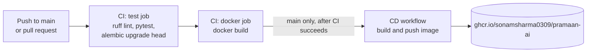
- **CI** (`.github/workflows/ci.yml`) runs on every push to `main` and every pull request: lint, the full test suite, a clean migration run and a Docker build.
- **CD** (`.github/workflows/cd.yml`) runs after CI succeeds on `main` and publishes the Docker image to GitHub Container Registry. It uses the built-in `GITHUB_TOKEN`, so no extra secrets are needed.
- Run the same checks locally with `make lint` and `make test`. The tests are written so that external services are mocked.

## Screenshots
All screenshots use **fictional demo data**.

| | |
|---|---|
| 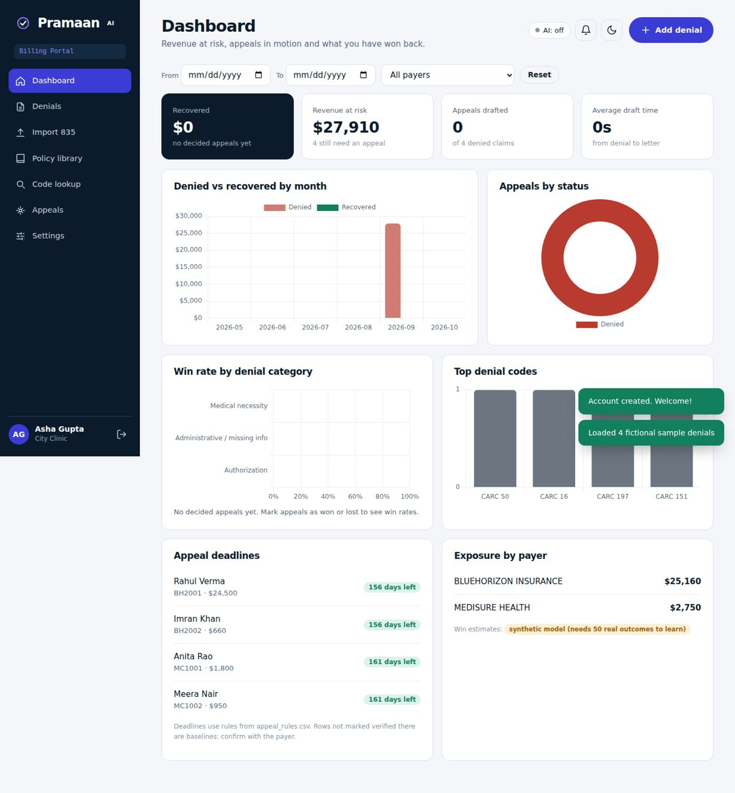 | 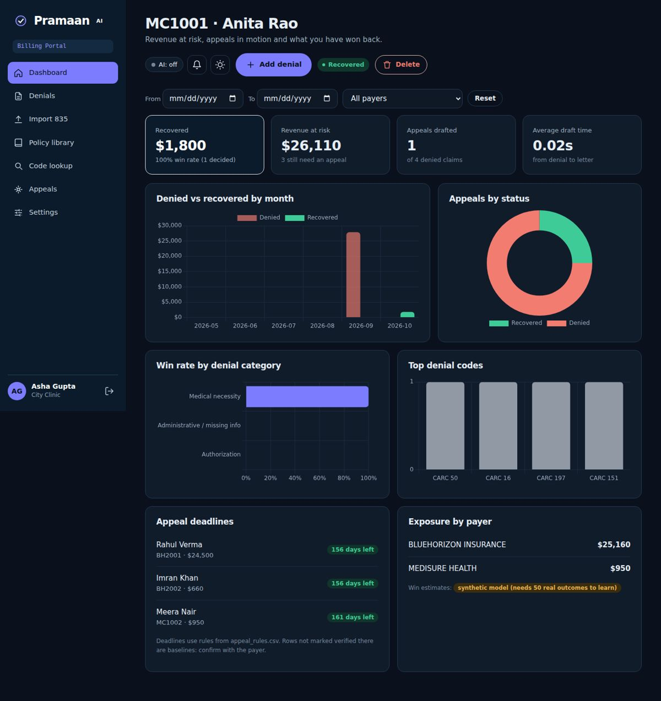 |
| 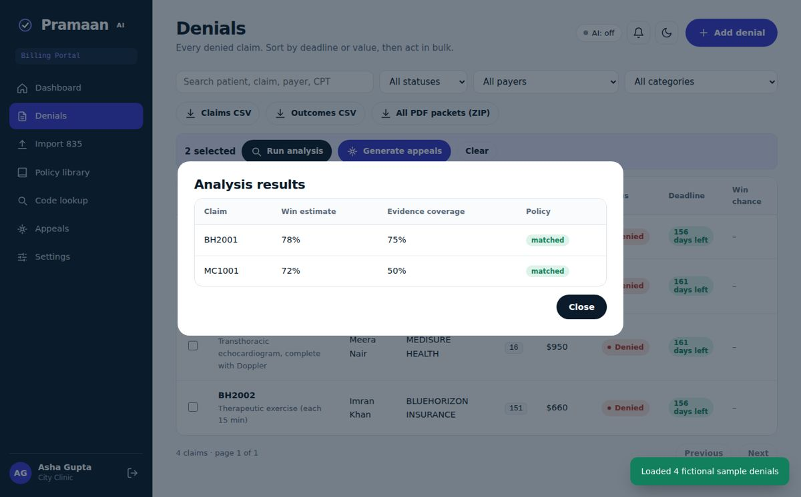 | 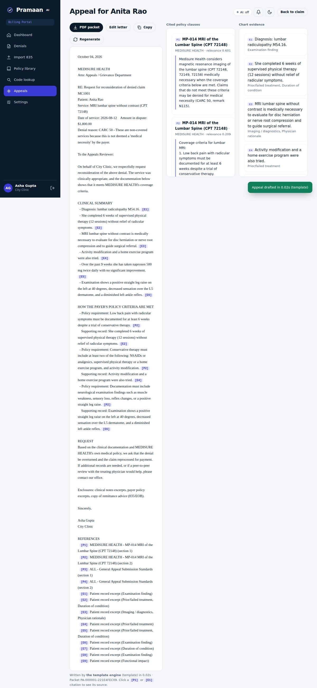 |
| 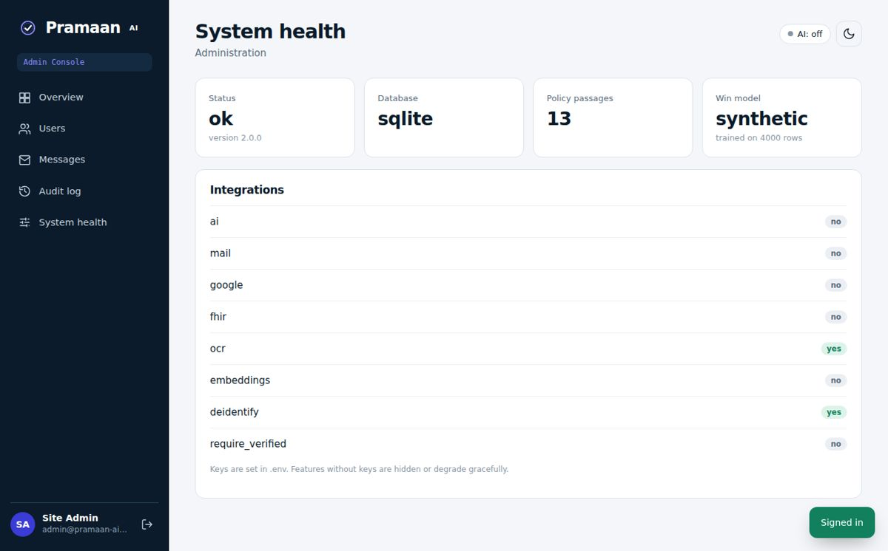 | 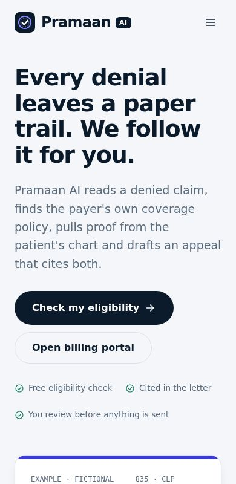 |

---

## Completed features
- [x] ANSI X12 835 / ERA parser (multi-transaction, patient-responsibility lines excluded)
- [x] CARC / RARC / EOB denial intelligence with appeal strategy and deadlines
- [x] Payer policy retrieval (TF-IDF, optional embeddings) with per-organisation isolation
- [x] Chart evidence mapping (met / partial / missing)
- [x] Cited appeal letters with citation guard and offline fallback
- [x] Win-probability estimate (synthetic, retrainable from real outcomes)
- [x] Watermarked PDF packets, CSV exports and ZIP of packets
- [x] Patient portal, Billing portal and Admin console
- [x] Cookie sessions with CSRF, rotating refresh tokens, optional TOTP 2FA
- [x] ICD-10 lookup and flag-gated FHIR import
- [x] Docker, Docker Compose, PostgreSQL support and Alembic migrations
- [x] 60 automated tests, linting and GitHub Actions CI/CD

## Limitations and honesty notes
- The **win probability is an estimate**. No public dataset of appeal outcomes exists, so it starts on synthetic data and says so in the UI and PDF until real outcomes are used to retrain it.
- Bundled **policies, payers and charts are fictional**. Real use needs real payer manuals (upload them in the Policy library).
- `appeal_rules.csv` ships with only baseline federal windows; unverified rows are labelled. A human must verify real payer deadlines.
- Retrieval is lexical by default; semantic embeddings are optional and add a ~1 GB dependency.
- Scanned-document OCR depends on Tesseract/Poppler (included in the Docker image).
- Verification status of this release: unit/integration tests and a headless-browser run were executed against SQLite with external services mocked. The Docker build, the PostgreSQL path, live Claude, Google sign-in and live SMTP were **not** executed in the authoring environment; run the smoke test below once in your own environment.
- SQLite is fine for a demo; use PostgreSQL (the compose default) for anything shared.

Smoke test after `docker compose up --build`:
```bash
curl localhost:8000/api/health
# sign up in the UI, Load sample data, run analysis, Generate appeal, Download PDF packet
```

## HIPAA and privacy warning
Pramaan AI is a **decision-support prototype, not a certified HIPAA-compliant system**, and it gives no legal or medical advice. Do **not** enter real patient data into a demo deployment. Before any real use you would need, at minimum: a signed BAA with every vendor that sees PHI (including the LLM provider), encryption at rest and in transit, access reviews, retention rules, breach procedures and your institution's approval. De-identification here is a best-effort safety net, not Safe-Harbor certification.

## Roadmap
- [ ] 837 claim parser
- [ ] FHIR bulk import
- [ ] Payer-specific deadline verification workflow
- [ ] Outcome-driven model monitoring
- [ ] E-fax / portal submission
- [ ] SSO (SAML)
- [ ] Org-level roles (admin vs biller)
- [ ] Multilingual patient letters.

---
*Pramaan AI is released for educational use. Add a `LICENSE` file of your choice before publishing (MIT or Apache-2.0 are common).*

---

## Project team
| Name | Role | GitHub |
|---|---|---|
| Vanshika Dixit | Team leader | [vanshika1711-cpu](https://github.com/vanshika1711-cpu) |
| Sonam Sharma | Team member | [sonamsharma0309](https://github.com/sonamsharma0309) |
| Dr. Sachin Kumar Yadav | Mentor, Assistant Professor, CSA | |

Repository: [github.com/sonamsharma0309/Pramaan-AI](https://github.com/sonamsharma0309/Pramaan-AI)

## License
No license has been chosen yet. Until one is added, all rights are reserved by the authors (see [LICENSE.md](LICENSE.md)). Pramaan AI is released for educational use.
